# GenUI コンポーネント集

GenUI（ブラウザ表示の `GenUI` トグル）が文書に入れるコンポーネントの一覧です。どれも**本文から抽出した内容**でできていて、元の行（`L5–12` などの行番号）へ戻れます。モデルは、抽出できた候補の中から節ごとに 1 つを選ぶか、何も出さないことを選ぶだけです。中身は書きません（[設計判断](design/llm-generated-aids.md)）。

- **節ごとのコンポーネント**（12 候補・9 種類）は、元になった行の直後に本文の一部として入ります。
- **文書全体のコンポーネント**（5 種類）は、冒頭の節の後に折り畳んで入ります。
- 1 つの文書に出るのは最大 8 個です。
- 各コンポーネントのヘッダには、ⓘ（なぜこれが選ばれたか）、ピン留め、非表示のボタンがあります。

各項目の Markdown は、そのまま `mdpeek serve` に渡すと同じコンポーネントになります（ファイルは [`components/src/`](components/src/)）。

## 節ごとのコンポーネント

### Steps

候補 id: `StepNavigator`

番号付きリスト（3 項目以上）を 1 ステップずつ進めるナビ。前へ / 次へで現在のステップが移り、進捗バーが伸びます。現在のステップは文書ごとにこのブラウザに保存されます。

````markdown
# 見本

## 手順

1. `main` へのマージを凍結する。
2. リリースコミットにタグを付ける。
3. デプロイパイプラインを実行する。
4. エラー率ダッシュボードを 15 分間監視する。
5. マージの凍結を解除する。
````

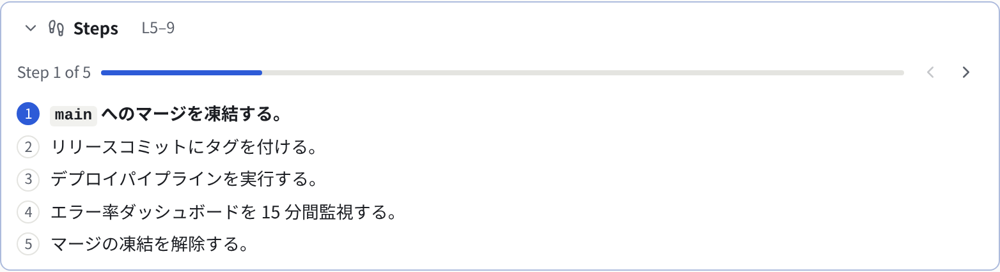

操作の例:

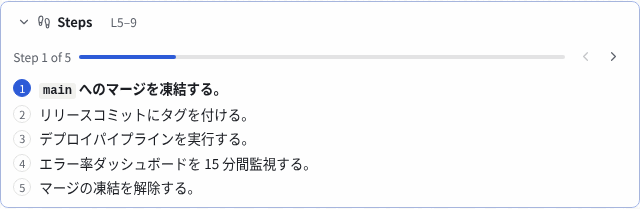

### Checklist

候補 id: `Checklist`

タスクリスト（2 項目以上）を操作できるチェックリストにします。元のリストの位置に置き換わり（#63）、*Original* で Markdown の表示に戻せます。チェックはこのブラウザにだけ保存され、ファイルは変更しません。*Reset to file* でファイルどおりに戻ります。

````markdown
# 見本

## 前提条件

- [ ] VPN に接続している
- [ ] オンコール担当者へ連絡済み
- [x] 変更チケットが承認されている
- [ ] ダッシュボードの閲覧権限がある
````

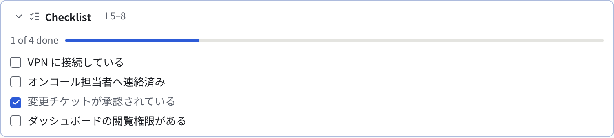

操作の例:

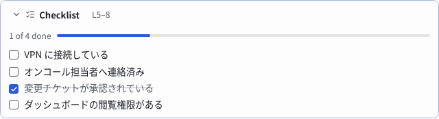

### Table（ステータス）

候補 id: `DataTable:status`

Status / 状態 などの列がある表を、ステータスを追える表にします。元の表の位置に置き換わります。

````markdown
# 見本

## 移行状況

| サービス | 担当 | Status |
|----------|------|--------|
| auth | 佐藤 | done |
| checkout | 鈴木 | in progress |
| billing | 高橋 | blocked |
| notify | 田中 | todo |
````

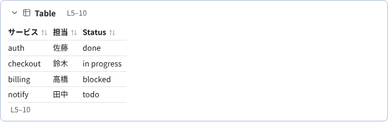

### Table（並べ替え・絞り込み）

候補 id: `DataTable:sortable`

3 行以上の表を、列見出しのクリックで並べ替え、文字で行を絞り込める表にします。元の表の位置に置き換わります。

````markdown
# 見本

## 設定値

| 項目 | 値 | 備考 |
|------|----|------|
| replicas | 6 | ピーク時は 10 |
| timeout | 30s | 上流の API に合わせる |
| retries | 2 | 冪等な操作のみ |
| region | ap-northeast-1 | 東京 |
| log_level | info | 障害時は debug |
| cache_ttl | 300s | 5 分 |
````

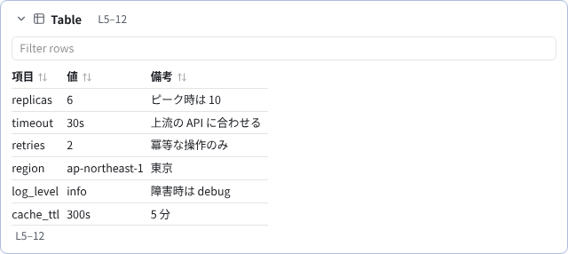

操作の例:

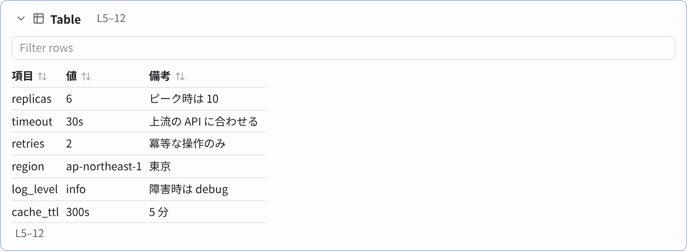

### Chart

候補 id: `Chart`

数値の列がある表をグラフにします（日付・月が並ぶ表は折れ線、それ以外は棒）。値はセルの文字列そのままで、矢印キーやポインタで各点の値を読めます。数値の列が複数あれば切り替えボタンが出ます。

````markdown
# 見本

## 月別リクエスト数

| 月 | リクエスト数 |
|----|-------------:|
| 2026-06 | 1,200,000 |
| 2026-07 | 1,350,000 |
| 2026-08 | 1,310,000 |
| 2026-09 | 1,520,000 |
| 2026-10 | 1,700,000 |
| 2026-11 | 1,810,000 |
````

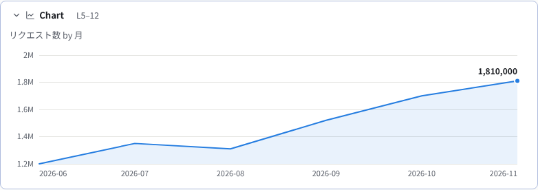

操作の例:

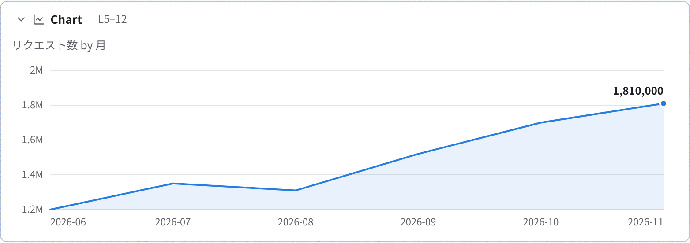

### Flow

候補 id: `NodeGraph`

`A → B` の矢印で書いた流れ（または from / to の表）をノードグラフにします。ノードを選ぶと、どこから来てどこへ行くかと、元の行が出ます。`--PASS-->` のようにラベル付きの分岐は結果ボタンで切り替えられます。

````markdown
# 見本

## 実行フロー

- Planning → Frontend, Backend
- Frontend, Backend → Verification
- Verification --PASS--> Release
- Verification --RETRY--> Backend
````

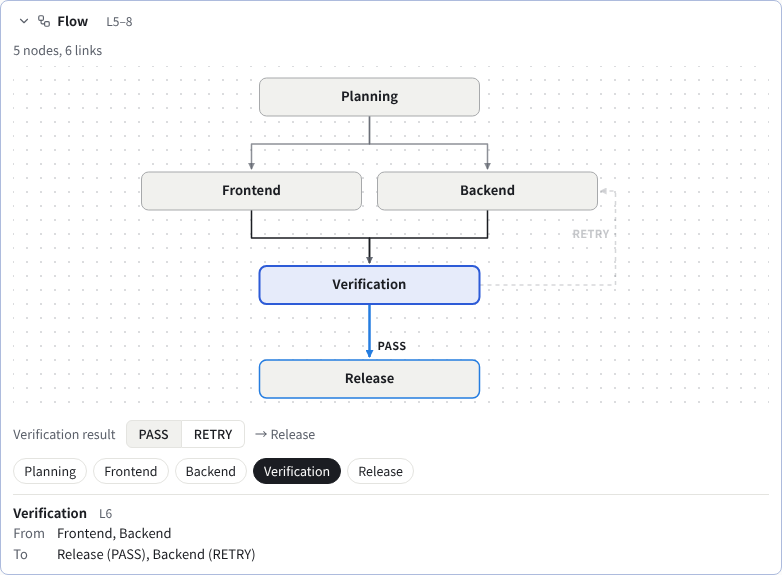

操作の例:

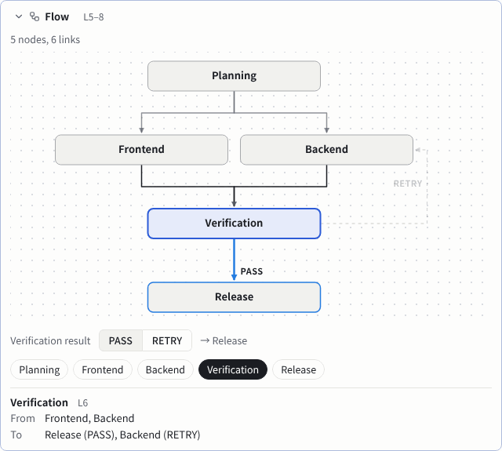

### Flow（罫線の図）

候補 id: `NodeGraph:diagram`

コードブロックに罫線（`┌─┐ │ ▶`）で描いた箱と矢印の図を、同じノードグラフで描き直します（#62）。読み取れない図からは何も作りません。

````markdown
# 見本

## 構成図

```
┌──────────┐     ┌──────────┐     ┌─────────────┐
│  Client  │────▶│ Gateway  │────▶│ payment-api │
└──────────┘     └──────────┘     └──────┬──────┘
                                         │
                                         ▼
                                  ┌─────────────┐
                                  │   ledger    │
                                  └─────────────┘
```
````

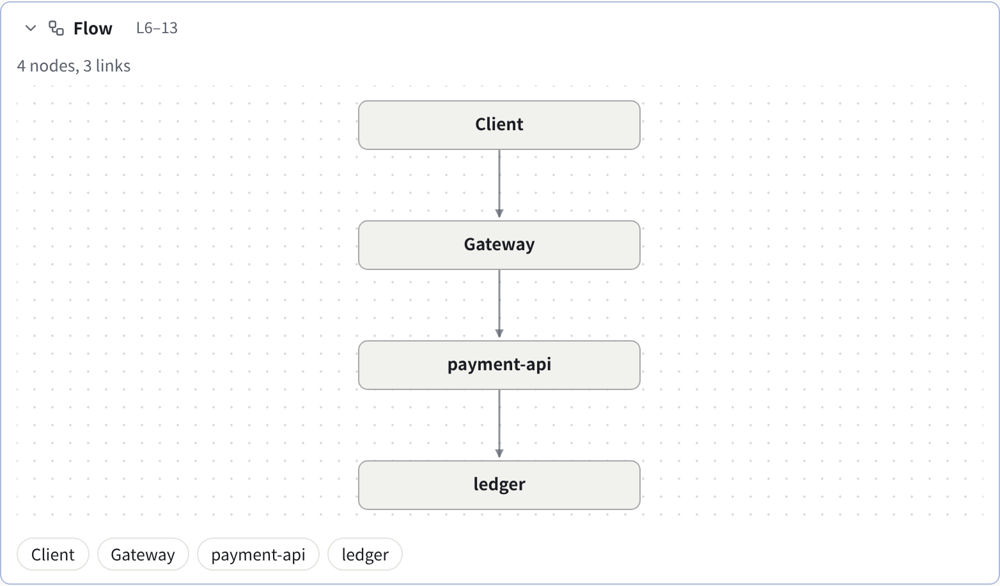

### Flow（処理の各段）

候補 id: `NodeGraph:stages`

`### 1. parser — markdown -> BlockTree` のように、小見出しが段階を 1 つずつ説明している節に、段階のフロー図を付けます（#65）。矢印には見出しに書かれた出力が付き、ノードから各小見出しへ移動できます。

````markdown
# 見本

## 処理の各段

段階ごとの入力と出力です。

### 1. parser — markdown -> BlockTree

Markdown を読み、ブロックの木にします。

### 2. analyzer — BlockTree -> semantic model

ブロックを分類します。

### 3. planner — semantic model -> UI plan

どの補助を出すかを決めます。

### 4. renderer — UI plan -> HTML

画面に描きます。
````

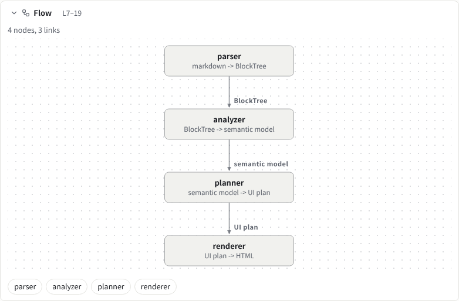

### Comparison

候補 id: `Comparison`

選択肢を列、評価軸を行に並べた点数付きの表を、選択肢ごとのカードにします。評価軸を選ぶとその軸で比べられ、平均の最高点に *Highest* が付きます。点数でない行（所要時間など）はカードの下に出ます。

````markdown
# 見本

## 実行方式の比較

| 観点 | Single Agent | Agent Swarm |
|------|-------------:|------------:|
| 実行速度 | 45 | 95 |
| コスト効率 | 95 | 45 |
| 品質 | 70 | 95 |
| 想定実行時間 | 28 min | 12 min |
````

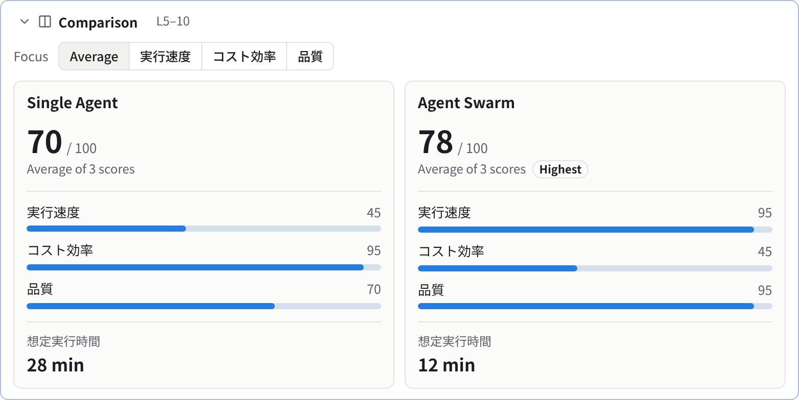

操作の例:

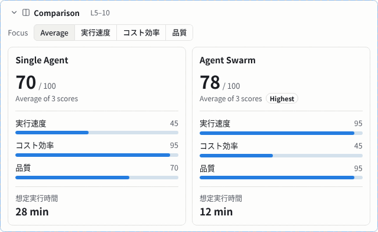

### Directory tree

候補 id: `DirectoryTree`

`├──` / `└──` で描いたディレクトリ構成を、開閉できるツリーにします（#64）。`#` の後のコメントを表示し、★ の付いた項目を強調します。マウスでもキーボード（矢印キー）でも開閉できます。

````markdown
# 見本

## ディレクトリ構成

```
markdown-peek/
├── Cargo.toml          # [workspace]
├── crates/
│   ├── mdpeek-core/    # ★ 解析の心臓部
│   │   └── src/
│   │       └── lib.rs
│   └── mdpeek-cli/     # バイナリ mdpeek
└── web/                # フロントエンド
    └── src/
        └── main.tsx
```
````

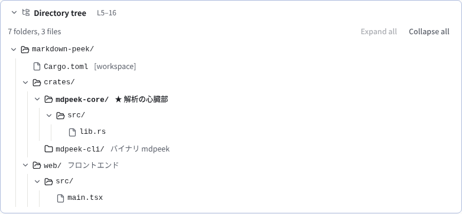

操作の例:

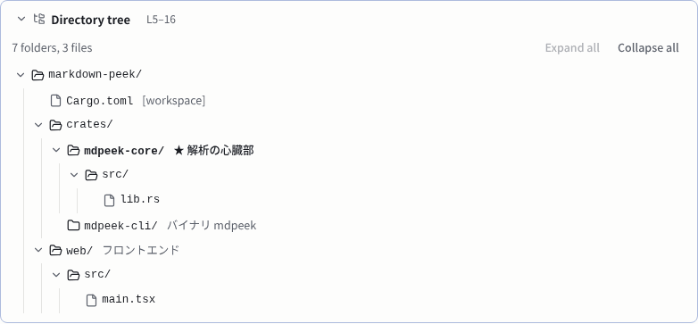

### Timeline

候補 id: `Timeline`

日付やバージョンが付いた行（3 つ以上）を時系列に並べます。

````markdown
# 見本

## リリース履歴

- 2026-06-01: v0.1 — ターミナル表示
- 2026-07-15: v0.2 — ブラウザ表示
- 2026-09-01: v0.3 — ライブ更新
- 2026-10-20: v0.4 — 読書補助
- 2026-11-28: v0.5 — GenUI
````

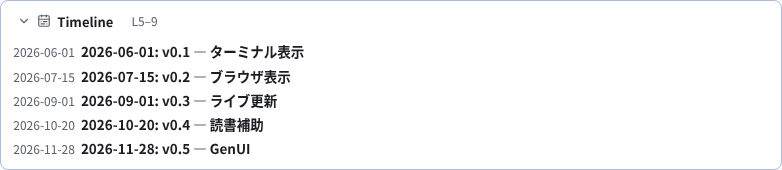

### Callout（リスク）

候補 id: `Callout:risk`

「リスク」「注意」などの見出しの節にある段落を、警告として目立たせます。

````markdown
# 見本

## リスク

データベースのマイグレーションを巻き戻すと、デプロイ後に書き込まれたデータが失われます。巻き戻しの前に必ずバックアップを取ってください。
````


## 文書全体のコンポーネント

### Outline by role

候補 id: `SemanticOutline`

見出しを役割（概要・設計・決定・リスク・未解決の問い …）ごとにまとめたアウトライン。見出しが 4 つ以上あり、役割が分かれている文書で出ます。

````markdown
# 決済サービス設計書

## 概要

決済サービスの構成と方針をまとめる。

## アーキテクチャ

API ゲートウェイの後ろに決済 API と台帳を置く。

## データモデル

注文と支払いは 1 対多で持つ。

## リスク

台帳の書き込みが遅れると残高がずれる。

## Open Questions

障害時の再送は誰が判断するか?

## 決定事項

台帳には PostgreSQL を採用する。
````

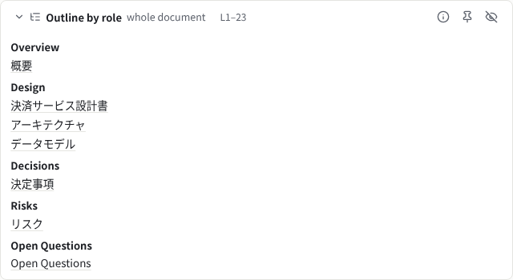

### Risks

候補 id: `RiskPanel`

「リスク」「注意」などの見出しの節に書かれた内容を一覧にします。

````markdown
# 移行計画

## 概要

決済データベースを新しいクラスタへ移す。

## リスク

移行中に書き込まれたデータが失われる可能性がある。

レプリケーションの遅延が 10 秒を超えると、読み取りが古くなる。

## 手順

移行は深夜帯に行う。
````


### Open questions

候補 id: `OpenQuestions`

「Open Questions」「未解決」「疑問」などの見出しの節に書かれた問いを一覧にします。

````markdown
# 監視の見直し

## 概要

アラートが多すぎて、本当の障害が埋もれている。

## Open Questions

監視のしきい値は 1% と 2% のどちらにするか?

ロールバックの判断は誰が行うか?

夜間の通知先はどこにするか?
````

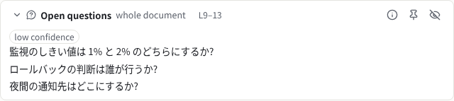

### Action items

候補 id: `ActionItems`

文書中のタスクリスト項目と `TODO:` を集め、チェックできる一覧にします。ほとんど完了済みのリスト（機能一覧など）では出ません。

````markdown
# リリース準備

## 作業

- [ ] 変更履歴を書く
- [ ] タグを付ける
- [x] テストを通す
- [ ] 告知文を用意する

## メモ

<!-- TODO: ロールバック手順を追記する -->
告知は前日に出す。
````

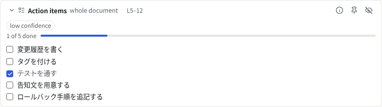

### Decisions

候補 id: `DecisionLog`

「採用する」「決定」「方針とする」「we decided」などを含む段落を決定事項として集めます。各行の `decided` と `medium` は今は固定の表示で、意味のある情報ではありません（下の注を参照）。

````markdown
# キャッシュ設計

## 背景

API の応答が遅く、同じ問い合わせが繰り返されている。

## 決定事項

キャッシュには Redis を採用する。

有効期限は 5 分とする方針とする。

設定ファイルの形式は TOML に決定した。
````


## 注

- **Glossary（用語集）** は種類としては残っていますが、今は出ません。略語は見つけられても定義を抽出できず、定義のない用語は出さない決まり（定義を推測で書かない）だからです。
- **Decisions の `decided` / `medium`**: `decided` は決定の状態（ほかに `proposed` / `rejected` / `superseded` がある）、`medium` は抽出の確からしさです。ただし今の抽出はキーワードで段落を拾うだけなので、どの行も `decided` と `medium` に固定されています。「却下」と書いた段落も `decided` になります。
- 画像は `web/e2e/components.spec.ts` で作ります（`MDPEEK_COMPONENT_MEDIA=1 npx playwright test e2e/components.spec.ts`、GIF には ImageMagick が必要）。この文書は `node docs/components/build.mjs` で作り直せます。
