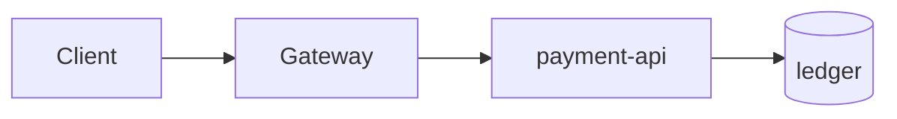

# 決済サービス デプロイ手順

この文書は決済サービス(payment-api)を本番環境へリリースするための手順書です。リリース担当者は作業前に全体を読み、前提条件をすべて満たしてから作業を始めてください。手順の途中で異常を検知した場合は、ためらわずにロールバックを実施します。

## 前提条件

- [ ] VPN に接続している
- [ ] オンコール担当者へ連絡済み
- [x] 変更チケットが承認されている
- [ ] ダッシュボードの閲覧権限がある

前提条件を満たさないままリリースを始めると、障害時の連絡や切り戻しが遅れます。特に夜間のリリースでは、オンコール担当者への連絡を省略しないでください。連絡の記録は変更チケットに残します。

## 手順

1. `main` へのマージを凍結する。
2. リリースコミットにタグを付ける。
3. デプロイパイプラインを実行する。
4. エラー率ダッシュボードを 15 分間監視する。
5. マージの凍結を解除する。

各手順の完了時刻を変更チケットに記録してください。パイプラインが途中で止まった場合は、ログの最初のエラーを確認し、再実行の前にリリース担当者と相談します。監視中にエラー率が 1% を超えた場合は、直ちにロールバックへ進みます。

## コマンド

```bash
git tag -a v2.3.0 -m "release"
git push origin v2.3.0
./scripts/deploy.sh production
```

## 設定値

| 項目 | 値 | 備考 |
|------|----|------|
| replicas | 6 | ピーク時は 10 |
| timeout | 30s | 上流の API に合わせる |
| retries | 2 | 冪等な操作のみ |

設定値は環境ごとに異なります[^env]。本番の値を変更するときは、必ずステージングで同じ値を一日以上運用してから反映してください。

## 構成図



レイテンシの目安は $p_{99} \le 250\,\mathrm{ms}$ です。

## ロールバック

> [!CAUTION]
> データベースのマイグレーションを巻き戻すと、デプロイ後に書き込まれたデータが失われます。

> [!NOTE]
> ロールバックの判断はリリース担当者が行います。

ロールバックは、前のタグを指定してパイプラインを再実行するだけで完了します。ただし、マイグレーションを含むリリースでは、先にデータの退避が必要です。退避の手順は別の文書にまとめています。

## 連絡先

障害時は #deploys チャンネルで連絡してください。夜間はオンコール担当者に電話します。

[^env]: ステージングと本番で replicas の既定値が異なります。
